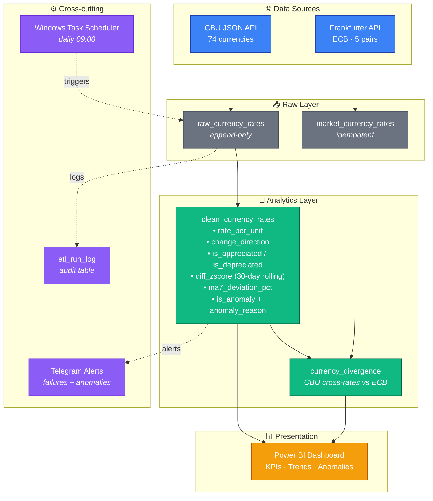

# 💱 Currency Exchange ETL & Analytics Pipeline

**Production-grade daily ETL pipeline** that fetches Uzbekistan Central Bank (CBU) currency rates, cross-checks them against European Central Bank (ECB) market rates via Frankfurter, detects statistical anomalies, and powers a Power BI analytics dashboard — with full monitoring, alerting, and audit logging.


---

## 📑 Table of Contents

- [Overview](#overview)
- [Architecture](#architecture)
- [Key Features](#key-features)
- [Tech Stack](#tech-stack)
- [Project Structure](#project-structure)
- [Setup](#setup)
- [How It Works](#how-it-works)
- [Sample Insights](#sample-insights)
- [Dashboard](#dashboard)
- [Known Limitations](#known-limitations)
- [Roadmap](#roadmap)
- [Lessons Learned](#lessons-learned)

---

## Overview

This project builds an **end-to-end data pipeline** from public financial APIs to an interactive Power BI dashboard. It goes well beyond a basic ETL:

- Two independent data sources are integrated and cross-validated
- Every pipeline run is logged with rich metadata for monitoring
- Anomalies are detected statistically and flagged with human-readable reasons
- Failures trigger real-time Telegram alerts
- Cross-rate divergence is computed to answer: *"Do CBU rates match global markets?"*

**Business question answered:**
> *How closely does the Central Bank of Uzbekistan track international currency markets, and can we programmatically detect when it doesn't?*

**Answer discovered from the data:**
> CBU tracks ECB market rates with sub-0.1% average divergence across USD, GBP, JPY, CHF, and CNY, with lag-driven volatility peaking at ~1% on days of major global market moves.

---

## Architecture



---

## Key Features

### 🔄 Robust ETL Pipeline
- **Idempotent daily loads** — safely re-runnable via DELETE + INSERT strategy
- **Append-only raw layer** — full audit trail, reprocessing safety net
- **Historical backfill support** — script fetches 90 days of history and skips dates already loaded
- **Retries with backoff** — API calls retry 3 times on network errors, 429 and 5xx responses
- **Automatic catch-up** — if a daily run is missed, the next run fetches the missing days from both sources
- **Fail-fast orchestration** — early stages fail loud, auxiliary stages fail soft

### 📊 Advanced Analytics Layer
- **Statistical anomaly detection** using rolling Z-scores + moving average deviation
- **Cross-rate divergence analysis** comparing CBU implied rates vs ECB market rates
- **Multiple derived fields** (`rate_per_unit`, `change_direction`, flags) precomputed for BI

### 🔔 Production Monitoring
- **Audit log table** records every run with duration, status, row counts, errors
- **Telegram bot integration** sends failure alerts with stack traces
- **Anomaly alerts** for statistically significant events (|z-score| > 3)
- **Non-fatal auxiliary stages** — market source failure doesn't take down core pipeline

### ⏱ Automation
- **Windows Task Scheduler** daily trigger at 09:00 Tashkent time
- **Rotating log file** at `logs/etl_log.txt` for post-run inspection
- **Exit-code aware** — scheduler-friendly success/failure signaling

---

## Tech Stack

| Layer | Technology |
|---|---|
| **Language** | Python 3.13 |
| **HTTP client** | `requests` |
| **Data transformation** | `pandas` |
| **Database** | Microsoft SQL Server 2019+ (T-SQL) |
| **ORM** | SQLAlchemy 2.0 + pyodbc |
| **Data sources** | Central Bank of Uzbekistan (JSON) + Frankfurter (ECB) |
| **Visualization** | Power BI Desktop |
| **Automation** | Windows Task Scheduler |
| **Alerting** | Telegram Bot API |
| **Secrets** | python-dotenv (.env files) |

---

## Project Structure

```
Currency Exchange/
├── py/
│   ├── config.py                # Central configuration, DB connection, logging
│   ├── http_utils.py            # API calls with retries
│   ├── audit.py                 # Pipeline run logging helper
│   ├── notifier.py              # Telegram notification helper
│   │
│   ├── extract_to_raw.py        # CBU JSON → raw_currency_rates
│   ├── transform_to_clean.py    # Cleanup + anomaly detection
│   ├── extract_market_rates.py  # Frankfurter → market_currency_rates
│   ├── compute_divergence.py    # Cross-rate divergence analytics
│   │
│   ├── backfill_history.py      # CBU historical loader (90 days)
│   ├── run_pipeline.py          # Main orchestrator (entry point)
│   │
│   ├── requirements.txt
│   ├── .env.example             # Template for .env (secrets, not in git)
│   ├── README.md
│   └── logs/
│       └── etl_log.txt          # Rotating execution log (not in git)
│
├── sql/
│   ├── create_database.sql
│   ├── create_raw_table.sql
│   ├── create_clean_table.sql
│   ├── create_audit_table.sql
│   ├── create_market_and_divergence_tables.sql
│   └── add_anomaly_columns.sql
│
├── CurrencyETL.pbix             # Power BI dashboard
└── currency_theme.json          # Power BI theme
```

---

## Setup

### Prerequisites
- Windows 10/11
- SQL Server 2019+ with SSMS
- ODBC Driver 17 or 18 for SQL Server
- Python 3.11+
- Power BI Desktop (for dashboard)
- Telegram account (for alerts, optional)

### Installation

**1. Clone repository:**
```powershell
git clone https://github.com/V4rthur/crrc_exchange.git
cd crrc_exchange/py
```

**2. Install Python dependencies:**
```powershell
pip install -r requirements.txt
```

**3. Create SQL Server database and tables:**
Run the SQL scripts from the `sql/` folder in order via SSMS:

```
create_database.sql
create_raw_table.sql
create_clean_table.sql
create_audit_table.sql
create_market_and_divergence_tables.sql
add_anomaly_columns.sql
```

**4. Create `.env` file** in `py/` folder (copy `.env.example`):
```env
TELEGRAM_BOT_TOKEN=your_bot_token_here
TELEGRAM_CHAT_ID=your_chat_id_here
```
The SQL Server connection defaults to `localhost` / `CurrencyETL` / ODBC Driver 17. Override it with `SQL_SERVER`, `SQL_DATABASE` and `SQL_DRIVER` in `.env` if yours differs.

**5. Verify DB connection:**
```powershell
python config.py
# Expected: ✅ Connected to database: CurrencyETL
```

**6. Backfill historical data (one-time):**
```powershell
python backfill_history.py
python extract_market_rates.py backfill 90
python transform_to_clean.py
python compute_divergence.py
```

**7. Run full pipeline:**
```powershell
python run_pipeline.py
```

**8. Schedule daily automation:**
Open Task Scheduler → Create Basic Task → Daily 09:00 → run `python run_pipeline.py` with working directory set to `py/` folder.

---

## How It Works

### Stage 1 — Extract (CBU)
- Fetches JSON from `https://cbu.uz/uz/arkhiv-kursov-valyut/json/`
- Retries up to 3 times with exponential backoff on network errors
- Also fetches any days missed since the last loaded rate date (up to 90)
- Parses ~74 currency records per rate date
- Appends only new rate dates to `raw_currency_rates` (never overwrites)
- Preserves original JSON in `raw_json` column for audit

### Stage 2 — Transform
- Reads full raw table into pandas DataFrame
- Deduplicates by `(currency_code, date)` — keeps latest `loaded_at`
- Computes derived fields:
  - `rate_per_unit = rate / nominal` (fair cross-currency comparison)
  - `change_direction` (Increased / Decreased / No Change)
  - `is_appreciated`, `is_depreciated` (binary flags)
- Runs statistical anomaly detection:
  - **Z-score** on daily `diff` vs 30-day rolling window (threshold: |z| > 2)
  - **7-day MA deviation** on `rate_uzs` (threshold: ±1.5%)
  - Combined `is_anomaly` flag + `anomaly_reason` text
- Loads to `clean_currency_rates` via DELETE + INSERT (idempotent)

### Stage 3 — Market Extract
- Fetches EUR-based rates for USD, GBP, JPY, CHF, CNY from Frankfurter, from the last loaded date up to today
- Loads into `market_currency_rates`
- **Non-fatal** — if Frankfurter is down, core pipeline still succeeds

### Stage 4 — Divergence
- Pivots CBU data to compute implied EUR/X cross-rates
- Joins with market rates on `(date, quote_currency)`
- Computes `absolute_divergence` and `pct_divergence`
- Rebuilds `currency_divergence` table (truncate + reload)

### Orchestration
- `run_pipeline.py` chains all 4 stages sequentially
- Audit log records: start/end times, duration, status, row counts, error stage
- Stages 1-2 fail loud (raise); stages 3-4 fail soft (log warning, continue)
- On failure or major anomaly (|z| > 3), sends Telegram notification

---

## Sample Insights

### Analytical Finding #1 — CBU tracks global markets tightly

| Currency | Avg Divergence | Std Dev | Interpretation |
|---|---|---|---|
| USD | -0.013% | 0.305% | Practically zero drift |
| GBP | -0.009% | 0.169% | Most stable pair |
| JPY | -0.068% | 0.500% | Highest volatility (BoJ sensitive) |
| CHF | +0.036% | 0.221% | Near-perfect alignment |
| CNY | -0.023% | 0.247% | Highly synchronized |

**Conclusion:** CBU does not manipulate cross-rates in any meaningful way. Small divergences correspond to publication lag on days of major global market moves.

### Analytical Finding #2 — Volatile currencies detected

Anomaly detector flagged 206 events across 4,662 rows (4.42% flag rate). Top offenders:
- **Lebanese Pound (LBP)** — consistent with country's ongoing currency crisis
- **Syrian Pound (SYP)** — expected given sanctions and economic instability
- **Kazakh Tenge (KZT)** — regional volatility from oil price swings

USD, EUR, and other managed majors showed **zero anomalies**, which matches expectations for stable currencies. Note that a |z| > 2 threshold flags roughly 5% of rows by construction, so the flag rate alone doesn't validate the detector.

---

## Dashboard

The Power BI report is `CurrencyETL.pbix` in the repository root (open with Power BI Desktop). It covers KPIs, historical trends, anomalies, and CBU vs ECB divergence.

---

## Known Limitations

- CBU publishes rates once per business day; weekends inherit Friday rates
- ECB doesn't publish weekends either — divergence gaps exist on Sat/Sun
- RUB not covered in market comparison (suspended from ECB reference basket in 2022)
- Windows-specific automation (Task Scheduler) — Linux would need cron equivalent
- No automated tests yet
- Anomaly detection thresholds are fixed; adaptive thresholds could improve early-history detection

---

## Roadmap

Features intentionally deferred to future iterations:

- **Docker containerization** — full docker-compose with SQL Server for one-command demo
- **Forecasting layer** — Prophet/statsmodels 7-day currency rate predictions
- **Power BI Service deployment** — scheduled cloud refresh with on-prem gateway
- **SCD Type 2 dim model** — historical currency metadata tracking
- **Star schema refactor** — fact/dimension tables for faster BI queries

---

## Lessons Learned

1. **Raw + clean separation is worth the effort** — being able to reprocess without re-fetching saved us multiple times during development
2. **Idempotency is non-negotiable** for scheduled pipelines — DELETE + INSERT beats append every time
3. **Non-fatal auxiliary stages** are a mature architectural choice — the whole pipeline shouldn't die because Frankfurter is down
4. **Alert on failures, not successes** — success notifications create alert fatigue and get ignored
5. **Statistical anomaly detection needs calibration** — thresholds that produce 2-8% flag rates catch signal without noise
6. **Cross-rate math beats direct comparison** — comparing implied EUR/USD from CBU vs actual EUR/USD from ECB is more insightful than comparing USD/UZS to a fabricated market USD/UZS

---

## License

Educational / portfolio project. Not affiliated with the Central Bank of Uzbekistan or the European Central Bank.

## Author

**Arthur** — Data Analytics & Business Intelligence student

Built as part of an advanced ETL coursework project, extended into a portfolio piece.